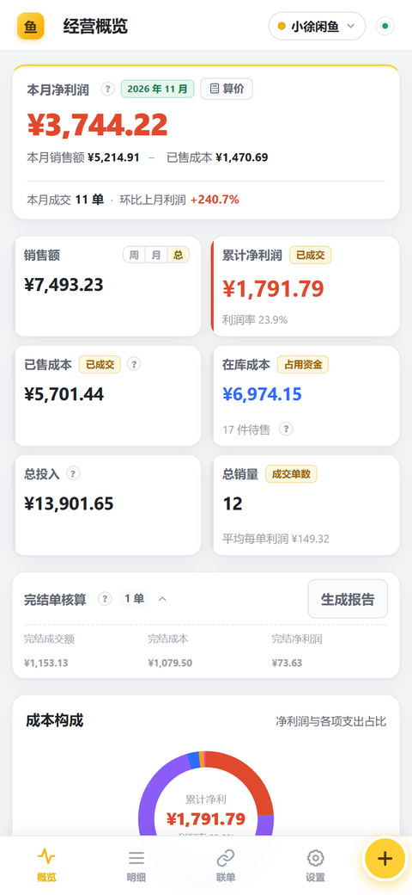
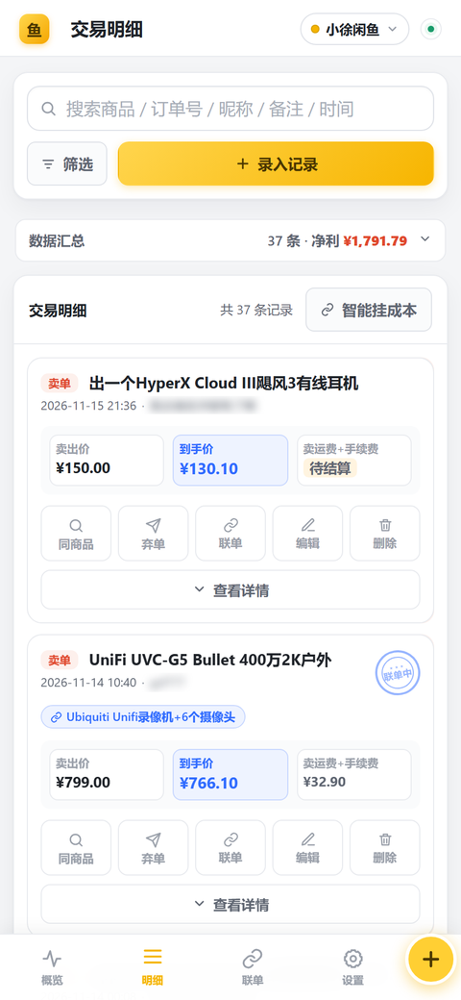
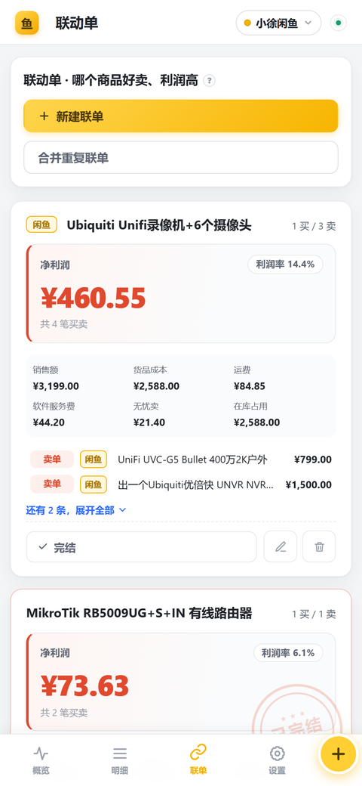
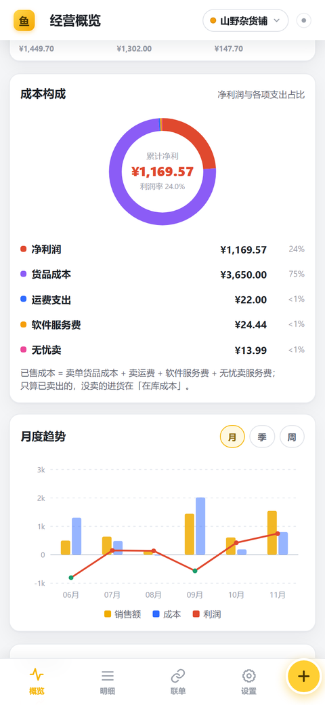
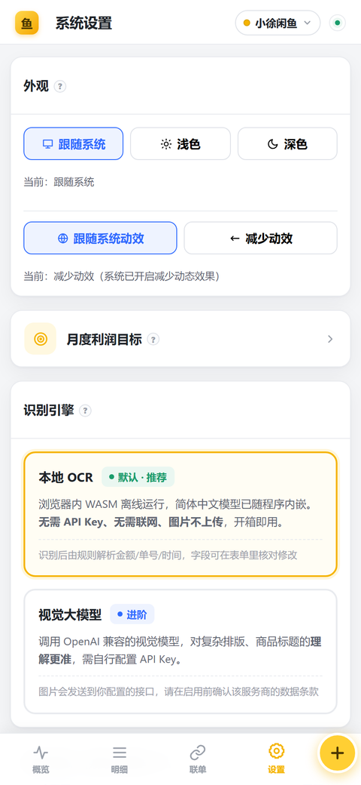
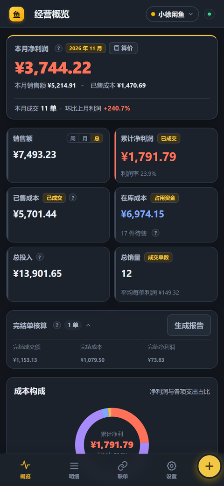
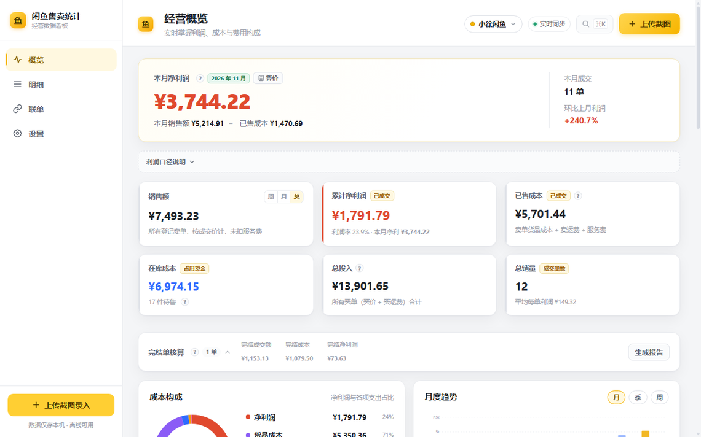

# 鱼助手 · 闲鱼售卖统计

> 自托管的闲鱼记账本 —— 把「进了多少货、卖掉多少、到底赚多少」算清楚。
> 单文件部署，数据只存在你自己的机器上。

<p>


</p>

---

## 为什么会有这个东西

闲鱼只告诉你「卖了多少钱」，不告诉你「赚了多少」。真算利润要减掉：进货价、买运费、卖运费、软件服务费、无忧卖服务费；一批货分几次卖出、一笔买单对应几笔卖单，还得把进货成本按比例摊到每笔卖单上。

拿 Excel 记两周就会放弃：改一条要重算一片，手机上看不动，截图存一堆对不上账。

鱼助手就是把这套核算做成一个**装在自己机器上的小网页**：手机上记一笔，电脑上看总账，成本自动摊，利润自动算。

---

## 特点

### 1. 算的是净利润，不是流水

- 成本口径完整：货品成本 + 买运费 + 卖运费 + 软件服务费 + 无忧卖服务费
- **联单成本分摊**：一组买卖挂成一个联单，买单成本按各卖单成交价占比自动分摊，不用手算
- **完结单核算**：只看点过「完结」的联单，单独一组数字（成交额 / 成本 / 净利润），和日常口径分得清
- 弃单不计成本、不占库存，但保留买进价可查

### 2. 闲鱼自动同步，失效会主动提醒你

- 手机扫码绑定一次，之后按天自动同步订单
- Cookie 失效不用等你自己发现：**自动同步失败会立刻弹红色提示**，并给出「去绑定」直达入口
- 支持多店铺，各自独立绑定、独立核算（一家店一个密码）

> 绑定必须在**你自己的电脑**上开真浏览器扫码 —— 服务器直接生成二维码会被闲鱼判为环境异常。原因和步骤见 [tools/README_bind.md](tools/README_bind.md)。

### 3. 截图识别，默认不联网

- 内置**本地 OCR**（WASM 离线运行，中文模型随程序打包）：不用 API Key、不用联网、图片不上传
- 想要更高的识别率，也可以接任意 OpenAI 兼容的视觉模型，密钥自己填
- 支付宝账单也能直接导入，和闲鱼订单自动配对

### 4. 手机上真的能用

不是把桌面表格缩小，而是按手机重做的一套交互：

- 标题最多一行，长名字「…」截断，完整标题在详情里
- **长按进入多选**，之后点卡片任意位置就能勾选，批量弃单 / 删除 / 编辑
- 编辑、删除收在卡片底部一处，滑动列表不会误触；「联单中 / 已完结」用圆章标状态，不遮标题
- 底部五个功能键带文字，不用猜图标
- 深浅色主题、减少动效开关，跟随系统

### 5. 数据是自己的

- 全部落在**一个 SQLite 文件**里，没有云端、没有账号体系、没有遥测
- 内置定时备份 + 手动导出 CSV（明细 / 利润表）
- 删错了有**回收站**，可撤销

### 6. 部署简单

- 单文件二进制：前端已经嵌进去，`./xianyu-stat` 起来就能用
- 或者 `docker compose up -d`，数据用命名卷分开存，删容器不丢

---

## 界面

> 截图为演示数据（店铺与商品均为虚构），不是真实交易记录。

| 首页概览 | 明细 | 联单 |
| :---: | :---: | :---: |
|  |  |  |
| 本月净利润、六项核心指标、完结单核算一行看完 | 每张卡片就是一个买卖动作，价格三格拆开写；带圆章的是联单中 | 一组货的总账：净利润、利润率、六项明细与关联单据 |

| 成本构成与趋势 | 设置 | 深色模式 |
| :---: | :---: | :---: |
|  |  |  |
| 环形图看钱花在哪，折线看每月利润走势（负值落在 0 线下方） | 主题、动效、识别引擎、备份都在这里 | 夜间自动跟随系统，颜色对比按深色重调过 |

电脑端是另一套布局，适合坐下来对账：



---

## 快速开始

### 方式一：单文件二进制（最省事）

从作者处拿到（或自己构建）`xianyu-stat`（Linux amd64 / arm64）或 `xianyu-stat.exe`（Windows），直接运行：

```bash
PORT=8080 ./xianyu-stat
```

浏览器打开 `http://localhost:8080`，第一次会让你设访问密码。

### 方式二：Docker Compose（绿联 NAS / UGOS）

绿联 NAS 自带 Docker Compose，适合把鱼助手长期挂在家里：电脑、手机和 NAS 在同一局域网时都能打开，电脑关机也不影响自动同步和定时备份。UGOS 的 `8080` 经常已被系统服务占用，所以项目默认改用 `18083`。

1. 在 UGOS 的「Docker → 项目」里新建项目 `xianyu-stat`，建议项目目录使用 `/volume1/docker/xianyu-stat`（以 NAS 实际共享目录为准）。
2. 下载 [docker-compose.yml](https://raw.githubusercontent.com/1316195118/Xianyu-Assistant/master/docker-compose.yml)，或直接把仓库里的这个文件粘贴到 UGOS 的「Docker → 项目 → Compose」。镜像固定使用 `latest`，不需要填写版本号。
3. 在项目目录新建 `.env`，把数据放到 UGOS 文件管理器能直接看到的三个文件夹：

   ```dotenv
   XIANYU_PORT=18083
   XIANYU_DATA_DIR=./data
   XIANYU_CONFIG_DIR=./config
   XIANYU_BACKUP_DIR=./backup
   ```

   如果 NAS 不能直连 GitHub，再补代理；能直连就留空。更新用的 Token 不需要，公开仓库保持为空：

   ```dotenv
   XIANYU_HTTP_PROXY=http://代理地址:7890
   XIANYU_HTTPS_PROXY=http://代理地址:7890
   XIANYU_NO_PROXY=127.0.0.1,localhost,::1
   ```

4. 在 UGOS 的 SSH 终端执行：

   ```bash
   cd /volume1/docker/xianyu-stat
   docker compose pull
   docker compose up -d
   docker compose logs -f
   ```

   也可以在 UGOS 项目界面里直接执行「拉取镜像」再「启动」。`latest` 会在项目发布新镜像时自动指向最新版。

5. 浏览器打开 `http://绿联NAS的局域网IP:18083`，第一次进入时设置管理密码。若改过 `.env` 里的 `XIANYU_PORT`，以实际端口为准。

日常维护：

- 更新：执行 `docker compose pull`，再执行 `docker compose up -d`。不需要改版本号或重新构建，容器重建后仍会使用原来的卷，数据不会丢。
- 备份：`./backup` 是程序生成的备份，`./data/xianyu.db` 是数据库本体，`./config` 是订单截图等附件；三个目录建议一起纳入 NAS 快照或定时备份。
- 排错：先看 `docker compose logs --tail=200`；健康状态可用 `docker compose ps` 查看。
- 安全：不要把 `18083` 直接映射到公网。需要外网访问时，在 NAS 或路由器上配置 HTTPS 反向代理，并只开放认证后的入口。

Compose 默认使用命名卷，适合普通 Docker 主机；上面 `.env` 的 `./data` 写法只是把数据切换到 NAS 可见目录。已有命名卷的用户不要随意改这三个路径，否则新容器会看到一套空数据。

### 方式三：从源码构建

需要 Go 1.27+、Node 18+：

```bash
bash build.sh
```

会依次装前端依赖、打包 Vue、嵌进 Go、编译出 `xianyu-stat.exe` 和 `xianyu-stat-linux-amd64`。

### 第一次使用

1. 设访问密码（可给不同店铺单独设密码）
2. 建一个店铺
3. 绑定闲鱼（见 [tools/README_bind.md](tools/README_bind.md)），或直接手动 / 截图录入
4. 在「设置 → 备份」里配一下自动备份目录

---

## 目录结构

```
server/        Go 后端：HTTP、SQLite、闲鱼同步、统计口径
  webroot/     构建后的前端产物（被 go:embed 打包进二进制）
web/           Vue 3 + Vite 前端
  src/views/   概览 / 明细 / 联单 / 设置
  src/components/
tools/         绑定工具、许可证收集、构建辅助
version/       版本号与更新日志（每次编译自动追加）
docs/          README 用的截图
```

---

## 数据与隐私

- 数据库是单个 `xianyu.db`，备份就是拷这个文件
- 闲鱼 Cookie 只存在本地数据库里，只在同步时发给你自己的服务
- 本地 OCR 在浏览器内跑，图片不出设备；只有你主动切到「视觉大模型」时，图片才会发到你填的那个接口
- 没有统计上报、没有远程配置、没有第三方脚本

---

## 更新日志

见 [version/CHANGELOG.md](version/CHANGELOG.md)（每次编译自动追加）。

---

## 版权与许可

Copyright © 2026 鱼助手（Xianyu-Assistant）作者。**保留所有权利。**

允许：

- 个人自用、修改、在自己的设备上部署
- 在保留本版权声明的前提下，向同样自用的朋友分享

需要事先授权：

- 商业用途、对外提供服务（SaaS / 代记账）
- 二次分发、打包进其他产品、去除版权声明

完整条款见 [LICENSE](LICENSE)。第三方组件的许可证与版权声明见 [THIRD_PARTY_NOTICES.md](THIRD_PARTY_NOTICES.md)。

## 免责声明

本项目与闲鱼、淘宝、阿里巴巴均无关联，也不是官方工具。仅用于**个人**的交易记账与利润核算；请自行遵守平台规则与当地法律法规，因使用本工具造成的账号风险或数据损失由使用者自行承担。软件按「现状」提供，不附带任何担保。
